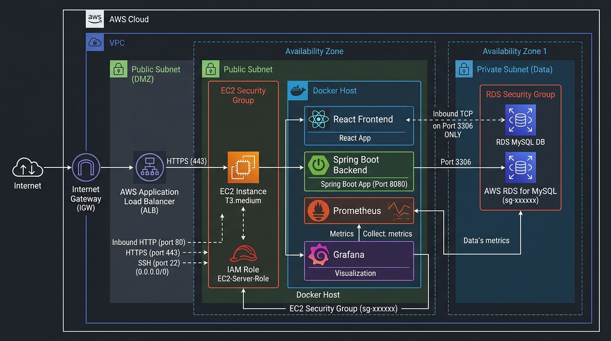

# AWS Cloud Architecture & Setup Guide

This document explains the production cloud architecture for hosting the **Todo Summary Assistant** using AWS EC2, AWS RDS (MySQL), Security Groups, and IAM roles.

---

## 1. High-Level Architecture Overview



```
[ Internet User ]
       │  HTTP / HTTPS (Port 80 / 443)
       ▼
 ┌─────────────────────────────────────────────────────────────┐
 │ AWS VPC (10.0.0.0/16)                                       │
 │                                                             │
 │  ┌───────────────────────────────────────────────────────┐  │
 │  │ Public Subnet (10.0.1.0/24)                           │  │
 │  │                                                       │  │
 │  │   [ EC2 Instance (t3.micro) ]                         │  │
 │  │   ┌────────────────────────────────────────────────┐  │  │
 │  │   │ Docker Host                                    │  │  │
 │  │   │  ├── React Frontend (Port 80)                  │  │  │
 │  │   │  ├── Spring Boot Backend (Port 8080)           │  │  │
 │  │   │  ├── Prometheus (Port 9090)                    │  │  │
 │  │   │  └── Grafana (Port 3001)                       │  │  │
 │  │   └────────────────────────────────────────────────┘  │  │
 │  │      Attached: IAM Role (No hardcoded AWS keys)       │  │
 │  │      Security Group: sg-ec2                           │  │
 │  └──────────────────────────┬────────────────────────────┘  │
 │                             │                               │
 │                             │ MySQL Traffic (Port 3306)     │
 │                             ▼ (Restricted to sg-ec2 ONLY)   │
 │  ┌───────────────────────────────────────────────────────┐  │
 │  │ Private DB Subnets (10.0.2.0/24 & 10.0.3.0/24)        │  │
 │  │                                                       │  │
 │  │   [ AWS RDS MySQL Instance (db.t3.micro) ]            │  │
 │  │   Security Group: sg-rds                              │  │
 │  │   (Not Publicly Accessible)                           │  │
 │  └───────────────────────────────────────────────────────┘  │
 └─────────────────────────────────────────────────────────────┘
```

---

## 2. Network & Subnet Design

1. **VPC**: `10.0.0.0/16` provides isolated cloud networking.
2. **Public Subnet**: `10.0.1.0/24` with an Internet Gateway (IGW) route to allow inbound web traffic to the EC2 instance.
3. **Private Subnets**: `10.0.2.0/24` and `10.0.3.0/24` across two availability zones for the RDS DB Subnet Group. No route to the internet, keeping the database completely private.

---

## 3. Security Groups (Least Privilege)

### A. EC2 Security Group (`sg-ec2`)
* **Inbound Rules**:
  * Port 80 (HTTP) from `0.0.0.0/0` (Public web traffic).
  * Port 443 (HTTPS) from `0.0.0.0/0` (Secure web traffic).
  * Port 22 (SSH) restricted to `YOUR_ADMIN_IP/32` (Remote management).
* **Outbound Rules**:
  * All traffic (`0.0.0.0/0`) to pull Docker images and reach Cohere & Slack APIs.

### B. RDS Security Group (`sg-rds`)
* **Inbound Rules**:
  * Port 3306 (MySQL) strictly from **Source: `sg-ec2`** (Security Group Chaining).
  * *NO direct internet access is permitted.*
* **Outbound Rules**:
  * All traffic allowed.

---

## 4. IAM Role for EC2 (No Hardcoded Credentials)

Instead of saving AWS access keys on the EC2 server, an **IAM Instance Profile** is attached:
* **Role Name**: `TodoApp-EC2-Role`
* **Attached Policies**:
  1. `AmazonSSMManagedInstanceCore`: Allows secure AWS Systems Manager access without opening SSH port 22.
  2. `CloudWatchAgentServerPolicy`: Allows streaming server metrics and logs to AWS CloudWatch.

---

## 5. Secret Management

Database passwords, Cohere API tokens, and Slack webhook URLs are never stored in git:
* **Production**: Stored in **AWS Systems Manager (SSM) Parameter Store** (SecureString) or passed securely via the Jenkins/GitHub Actions credential store.
* **EC2 Container Injection**: Loaded at container runtime via `-e DB_PASSWORD=$DB_PASSWORD`.
